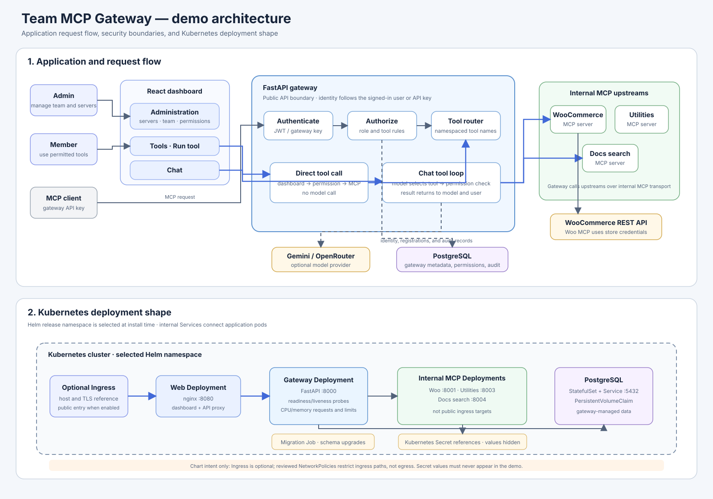
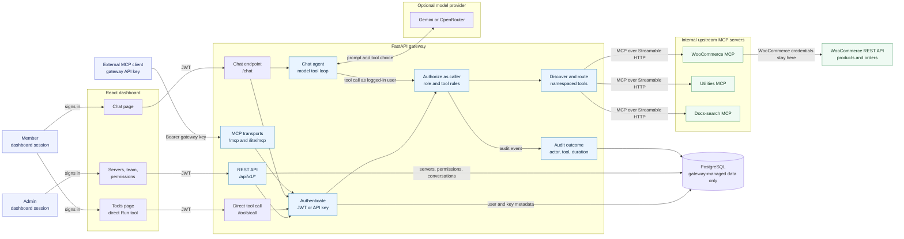
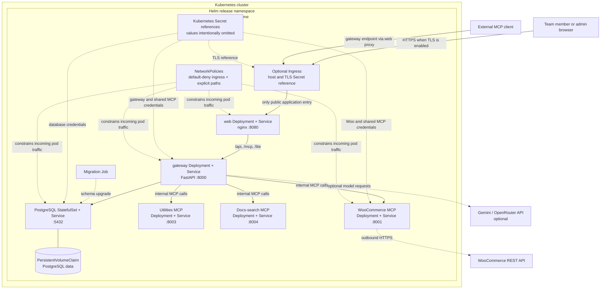

# Architecture diagram for the demo

[Open the standalone SVG](architecture-demo.svg)

This page shows the current source-level design for the team MCP gateway. It describes the
request paths and Helm resources present in the repository; it does not claim that a Kubernetes
release is running or has been verified.

## Application and request flow

### Reading the flow

- The dashboard's **Tools → Run tool** path calls the gateway directly. It does not call Gemini or
  OpenRouter, but still uses the signed-in user's identity, permission checks, and audit path.
- The Chat path first asks the configured model to choose a tool. The gateway executes that tool as
  the signed-in user, returns the result to the model, then returns the assistant response.
- External MCP clients use a gateway API key and `/mcp` or `/lite/mcp`. Tool names include the
  server slug, such as `woocommerce__list_products`.
- The gateway stores users, hashed gateway keys, server registrations, permission rules, audit events,
  and chat history. Product and order records stay in WooCommerce.
- The gateway-to-MCP credential is distinct from the WooCommerce Consumer Key/Secret. The latter are
  used by the WooCommerce MCP server when it calls the WooCommerce REST API.

## Kubernetes deployment shape

### Kubernetes notes for the presenter

- The chart templates do not create a Namespace object. Install the Helm release into the namespace
  chosen for that environment.
- Ingress is optional and routes to the web service. The web service proxies dashboard API and MCP
  paths to the gateway. The gateway, MCP services, and PostgreSQL have internal Services.
- PostgreSQL uses a StatefulSet and a PVC. The chart also includes a migration Job.
- The templates define readiness/liveness probes and resource request/limit settings. Use the
  selected Helm values to show their actual configured values; do not guess those numbers.
- NetworkPolicies in the chart restrict **ingress** paths: traffic to web, web to gateway, gateway
  to MCP servers, and gateway to PostgreSQL. The reviewed policies do not restrict egress; do not
  claim that they prevent outbound connections from a compromised pod.
- Secret values are supplied through Kubernetes Secret references. Show the references or secret
  names only, never decoded values. Compare local and VPS Helm values with credential fields hidden.
- The Helm chart files establish intended resources, not proof that a cluster deployment succeeded.

## Chat quota and demo fallback

The direct Tools page is the reliable live path for product operations when the model provider is
throttled. In the current gateway code, no configured provider produces `503`; the gateway's own
per-user chat limiter produces `429`; provider `429` or `5xx` failures are retried once and then
returned through the chat route as `502`.
